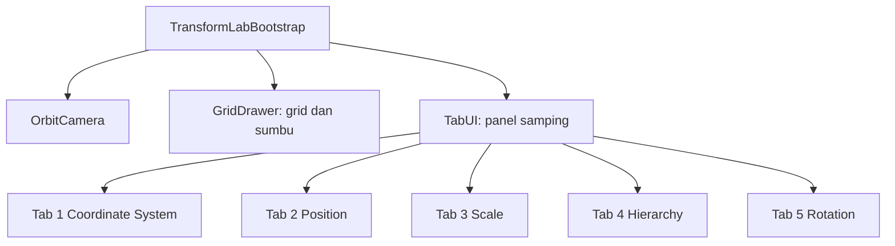

# Transform Lab — Kelompok Thiya & Jei

Aplikasi Unity 3D bertema **Coordinate Systems and Transformations**, dengan tampilan bergaya Desmos: grid 3D, orbit camera, dan panel samping berisi lima tab.

Produk: **Transform Lab**. Hanya memakai Transform API Unity, tanpa perhitungan matriks manual.

## Status

Tahap **kerangka dasar** selesai: grid 3D, sumbu berwarna, orbit camera, dan panel samping dengan lima tab kosong (hanya judul). Skrip belum diuji di Unity.

Belum ada: isi kelima tab, teks definisi per tab, snippet C# di layar, demo gimbal lock, plot permukaan opsional.

Titik implementasi: `Assets/Scripts/TransformLabBootstrap.cs`, `OrbitCamera.cs`, `GridDrawer.cs`, `TabUI.cs`. Kerangka dibangun otomatis saat scene apa pun dimulai; scene tidak perlu diedit.

## Konsep

Satu aplikasi, lima tab. Setiap tab memuat sliders dan input angka, teks definisi singkat (pengertian), dan snippet C# dari properti `Transform` yang sedang dipakai, tampil saat nilai berubah.

| No | Tab | Isi | Pemilik |
|----|-----|-----|---------|
| 1 | Coordinate System | Sumbu X/Y/Z, Cartesian 3D, left- vs right-handed, sistem koordinat Unity (left-handed, Y up) | Thiya |
| 2 | Position | `position`, `localPosition`, `Translate()`, world vs local | Thiya |
| 3 | Scale | `localScale`, `lossyScale`, scaling per sumbu | Thiya |
| 4 | Hierarchy | Parent-child, pengaruh transformasi parent terhadap child | Jei |
| 5 | Rotation | Rotasi per sumbu, Euler vs quaternion, gimbal lock dan cara menghindarinya, `rotation`, `eulerAngles` | Jei |

Tab 5 harus menunjukkan cara **menghindari** gimbal lock (`Quaternion.AngleAxis` atau `Transform.RotateAround`), bukan hanya masalahnya.

Plot permukaan preset (mis. z = x² + y²) bersifat opsional, hanya jika semuanya sudah selesai.

### Batasan teknis (jangan sampai salah)

- "Global scale" bukan properti Unity yang bisa di-set. Yang ada hanya `lossyScale` (read-only, hanya perkiraan jika parent berotasi dan skala tidak seragam). Beri label **"lossy scale"**.
- `Transform.Translate()` default-nya `Space.Self`. Beri `Space.World` untuk world space.
- `Transform` menyimpan rotasi sebagai quaternion, jadi mengatur `eulerAngles` tidak akan terlihat gimbal lock. Demo harus menerapkan tiga rotasi X, Y, Z manual dengan urutan tetap, sumbu tengah mendekati 90 derajat, lalu dibandingkan dengan quaternion.
- Nilai `eulerAngles` yang dibaca bisa berbeda dari yang di-set, padahal mewakili rotasi yang sama.
- Unity left-handed, Y up. Desmos 3D right-handed, Z up. Berpindah handedness berarti mencerminkan satu sumbu, bukan sekadar mengganti label.

### Cakupan materi

Pengertian sistem koordinat; sumbu X, Y, Z; koordinat Cartesian 3D; left- vs right-handed; sistem koordinat Unity; pengertian posisi; World vs Local Position; translasi; `Transform.position`; `Transform.localPosition` dan `Transform.Translate()`; pengertian scaling; scaling per sumbu; `Transform.localScale`; Local vs Global Scale; hubungan Parent dan Child; pengaruh transformasi parent terhadap child; pengertian rotasi; rotasi per sumbu; Euler Angles; Quaternion; perbedaan Euler dan Quaternion; Gimbal Lock dan cara menghindarinya; `Transform.rotation` dan `Transform.eulerAngles`.

## Stack

| Komponen | Teknologi |
|---|---|
| Engine | Unity 3D (versi: `____`, harus sama untuk semua anggota; minimal 2022.2) |
| Bahasa | C# |
| UI | UGUI bawaan (`Canvas`, `Text` legacy), dibuat dari kode |
| Input | Input Manager lama (*Active Input Handling*: Old atau Both) |
| Rendering grid | `LineRenderer` |
| Kontrol versi | Git + GitHub |

Stack ditetapkan oleh proyek. Jangan menambah atau mengganti package tanpa disepakati berdua.

## Tim & area

| Peran | Orang | Area (lihat `.github/CODEOWNERS`) |
|---|---|---|
| Tab 1–3 | [@artificialangel](https://github.com/artificialangel) (Thiya) | Coordinate System, Position, Scale |
| Tab 4–5 | [@jeipra](https://github.com/jeipra) (Jei) | Hierarchy, Rotation |

`TransformLabBootstrap`, `OrbitCamera`, `GridDrawer`, `TabUI`, README, dan `.github/` milik bersama. Aturan tim lengkap: [`docs/team.md`](docs/team.md).

## Setup

1. **Unity Hub** dengan versi Unity yang sama untuk kedua anggota (isi versinya di tabel Stack).
2. **Git.**
3. Clone repositori:

   ```bash
   git clone <url-repo>
   cd <nama-repo>
   ```

4. Buka folder proyek lewat Unity Hub. Pastikan di *Project Settings*:
   - *Editor > Version Control Mode*: **Visible Meta Files**
   - *Editor > Asset Serialization Mode*: **Force Text**
   - *Player > Active Input Handling*: **Input Manager (Old)** atau **Both**
5. Buka scene apa pun, lalu tekan **Play**. Grid, orbit camera, dan panel tab muncul otomatis.

Kontrol: klik kanan + drag untuk orbit, scroll untuk zoom.

Jika repositori dimulai dari zip kerangka: buat proyek 3D kosong di Unity Hub, salin isi zip ke folder proyek itu, lalu `git init`.

## Alur kerja Git

- **Tidak boleh commit langsung ke `main`.** Semua lewat Pull Request.
- Nama branch: `<tipe>/<area>-<deskripsi>`, contoh `feat/rotation-gimbal-demo`, `feat/position-ui`, `fix/core-orbit-camera`.
- Commit memakai [Conventional Commits](https://www.conventionalcommits.org/): `feat:`, `fix:`, `docs:`, `chore:`.
- PR wajib mencentang semua item "Cek sebelum merge" di template PR. Approval tidak wajib, boleh merge PR sendiri, tetapi minta review jika menyentuh area orang lain. Merge pakai **squash**, jadi `git log` di `main` = daftar kontribusi per orang.
- Commit file `.meta` bersama aset aslinya. Satu orang mengedit scene `.unity` dalam satu waktu untuk menghindari konflik.

```bash
git switch main && git pull
git switch -c feat/rotation-gimbal-demo
# ...kerja, commit...
git push -u origin feat/rotation-gimbal-demo
gh pr create --fill
```

## Arsitektur

Satu bootstrap membangun seluruh aplikasi saat scene dimulai. Isi tiap tab ditambahkan di panel konten tab masing-masing.



## Tugas

**Bersama**
- [x] Kerangka dasar: grid 3D, orbit camera, panel samping, lima tab kosong
- [ ] Uji kerangka di Unity (versi yang dipilih)
- [ ] Persiapan demo Zoom dan latihan presentasi

**Thiya — @artificialangel**
- [ ] Tab 1 Coordinate System: sumbu, Cartesian 3D, left- vs right-handed, sistem Unity
- [ ] Tab 2 Position: `position`, `localPosition`, `Translate()`, world vs local
- [ ] Tab 3 Scale: `localScale`, `lossyScale`, scaling per sumbu
- [ ] Teks definisi dan snippet C# untuk tab 1–3

**Jei — @jeipra**
- [ ] Tab 4 Hierarchy: parent-child, pengaruh parent terhadap child
- [ ] Tab 5 Rotation: rotasi per sumbu, Euler vs quaternion, `rotation`, `eulerAngles`
- [ ] Demo gimbal lock (tiga rotasi manual) dan cara menghindarinya
- [ ] Teks definisi dan snippet C# untuk tab 4–5

**Opsional (hanya jika semua selesai)**
- [ ] Plot permukaan preset, mis. z = x² + y²

## Menuju demo (24 November 2026)

| Target | Pemilik |
|---|---|
| Kerangka teruji di Unity | Semua |
| Tab 1–3 berfungsi | Thiya |
| Tab 4–5 berfungsi, termasuk demo gimbal lock | Jei |
| Latihan demo Zoom | Semua |

Rubrik demo: tampilkan tiap tab langsung dari aplikasi Unity (Play mode atau build). Siapkan cadangan, mis. rekaman layar, jika koneksi Zoom bermasalah.

## Pertanyaan terbuka

- Versi Unity yang dipakai (`____`).
- Apakah isi tiap tab dipisah ke skrip sendiri (mengubah `TabUI.cs`) agar tidak bentrok saat merge.
- URL repositori.

## Referensi (hanya pembanding, cantumkan sumber dan cek lisensi jika dipakai)

- udacity/FCND-Gimbal-Demo (demo gimbal lock)
- BasmanovDaniil/GimbalLock (demo gimbal lock, WebGL)
- manaporkun/UnityRuntimeTransformHandles (gizmo runtime; bisa melemahkan tujuan "menunjukkan pemahaman Transform")
- nuwandda/Computer-Graphics (tugas kuliah dengan kelas matriks)
